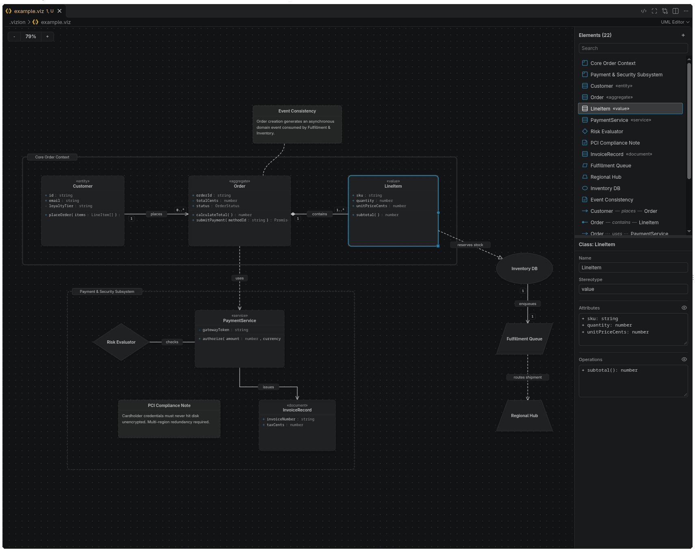

# Vizion

A visual UML editor for VS Code. Diagram classes, notes, frames and relationships on a canvas, saved as readable JSON.

## Features

- **Visual editing**: canvas with grid snapping, class/note/frame/shape nodes, and resizing.
- **Relations**: different routing stlyes, labels, multiplicities, and customizable endpoint shapes.
- **Inspector**: edit names, stereotypes, members, note content, and geometry.
- **Export**: save the diagram as PNG or copy it to the clipboard.
- **AI-friendly**: every document carries guidance that helps coding agents interpret and edit it safely.



## Install

1. Download `vizion-0.3.0.vsix` below.
2. Open the Command Palette (**Ctrl+Shift+P**)
3. Select **Extensions: Intall from VSIX...**
4. Select `vizion-0.3.0.vsix`

Or clone the project and run:

```bash
npm ci
npm run package
code --install-extension vizion-0.3.0.vsix
```


## Development

```bash
npm run typecheck
npm run check
npm test
npm run build
```

Then press **F5**, and open `.vizion/example.viz`.